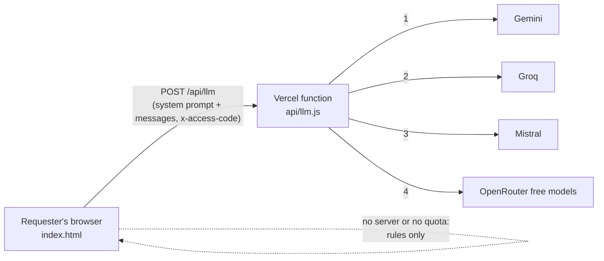
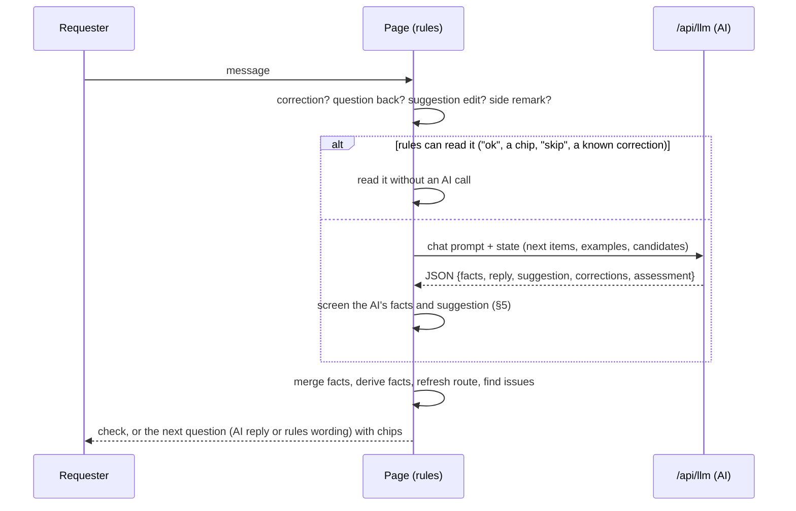

# Guided Intake Chat: Architecture

| | |
|---|---|
| Last updated | 18 November 2026 |
| Related | [PRD](PRD.md) · [Design](DESIGN.md) · the in-app **How it works** panel, which documents every rule and prompt, and the in-app **Decision tree** for business readers; both are generated from the code |

## 1. Overview



There are two deployable parts:

| Part | Role |
|---|---|
| `index.html` | The whole application: screen, rules engine, conversation loop, prompts, outputs, reference data, the How it works specification and the Decision tree. No build step and no dependencies (Google Fonts only). |
| `api/llm.js` | A thin serverless proxy. It holds the AI keys, enforces the access code, tries the providers in order with cooldowns, and returns the model's text. It decides nothing about the request. |
| `vercel.json` | Gives the function 60 s and sets the response security headers. |

**Design rule: the rules decide, the AI talks.**
- The browser picks the route, the questions, the Level 4 category, the ICT and outsourcing flags, and every check,
  deterministically.
- The AI phrases questions, reads free-text answers into facts, suggests answers and writes the description.
- Everything the AI returns is screened before it is used (§5).

## 2. `index.html`

**Inline data:** one JSON block, `<script id="taxonomy-data" type="application/json">`, holding the Level 4 list,
suppliers, frameworks and catalogue (§7).

**One inline script with numbered sections:**

| # | Section | Contents |
|---|---|---|
| 1 | Configuration | `CONFIG`: provider mode, access code, `?ai=` test override, currency, `thresholds` (`catalogueNoQtyMax`, `formMin`, `leadMin`, `materialityMin`, `qualityMin`, `answerTip`) |
| 2 | Reference data | `CATEGORIES` (20 buying categories with type and keywords), `L4`, `CONTRACTS`, `PREFERRED_L4`, `CATALOGUE` (from the data block), legal entities, rule sets (EBA/GL/2019/02, EBA/GL/2026/09) |
| 3 | Routes | `CHANNELS`, `FACTS` (every question: label, wording, example, choices), `requiredFor(route, f)`, `STAGES`, kind-of-work rules (`kindOf`, `isOngoing`) |
| 4 | State | One global `S`: messages, facts `S.f`, derived facts, route `S.det`, open questions `S.missing`, suggestions, quality, description `S.sd` |
| 5 | Rules engine | Category and Level 4 matching, `determine()` (route and channel), `whoLeads()` (who leads new demand, on the annual value), `reviewFlags()` (review flags from the rule cards), `nextSteps()`, ICT and outsourcing decision tree, answer checks (`findIssue`), dates, money, suppliers |
| 6 | AI client | `callLLM()` (POST to `/api/llm`, 58 s timeout, short retries on a fast 429), chat system prompt and state block |
| 7 | Conversation loop | `handleTurn()`: corrections, questions back, suggestion edits, the AI call or rules-only reading, screening, merging, checks, next question |
| 8 | Results | `determine`'s route card, `buildDoc()` (description or purchase request), quality score, submit and JSON payload |
| 9 | Render | Chat, cards, step bar, side panel, editor |
| 10 | How it works and Decision tree | `specModel()`: the specification built from the live constants and the exact prompts. `treeModel()`: the same rules as business decisions (yes/no ladders, the question → decision index, worked examples), with `treeFigure()` drawing the whole tree as one SVG picture (Mermaid in the download). Both open in `openPanel()` with Markdown download and print |
| 11 | Wiring | Event handlers, access gate, start-up |

## 3. A turn, step by step



`refresh()` re-runs on every turn:
1. `deriveFacts()`: hosting, in-house, entity, Level 4, purpose and so on;
2. `determine()`: the route;
3. `requiredFor()`: the questions;
4. ordering by stage into `S.missing`.

A change of category, value or supplier therefore re-routes on the spot.

## 4. AI calls

| Call | When | Gets | Returns |
|---|---|---|---|
| A. Chat turn | A typed answer that the rules can't read alone | System prompt (role, rules, fact keys, about 20 Level 4 candidates on the first message, after "None of these" and at the check step, catalogue entries of the category), last 6 messages cut to 400 characters, state block | JSON: facts (on the first message also `l4`, `l4_terms`, `l4_alt`), reply, asking, choices, suggestion, corrections, answers_question, assessment |
| B. Suggestion | A suggestion item with no usable suggestion from A | The question, known facts, the rules' standard draft | One suggestion string, one "Label: …" line per bundle line |
| C. Documents | New demand or call-off, once all details are in | Conversation, facts, category, ICT and outsourcing results, route, up to 5 Level 4 candidates | Description fields (hard word limits), the Level 4 re-check (new demand), up to 2 quality remarks |
| D. Document change | "Make it shorter" once a description exists | The current description and the request | The updated description |

There is no AI call for catalogue orders: the purchase request is built from the answers.

**Rules as data.** Thresholds, channels, category flags and the routing rules live in `db/seed/*.json` and reach the
page as its built-in configuration: the `config-defaults` JSON block, written by `scripts/build_defaults.js`.
`applyConfig()` fills `CONFIG.thresholds`, `CHANNELS`, `LEAD_DAYS`, the category flags and `RULES` in place. A rule is a
decision table: ordered rows of conditions on facts (`{fact, op, value}`, a value can name a threshold), the first row
that holds gives the outcome, and the last row is the "otherwise" row. `engine.js` evaluates, validates and tests
them; the same file runs in the page and in Node. `determine()` builds the fact view (`leadView` plus the catalogue
and contract matches), runs R01 (catalogue), R02 (existing contract), R11 (who leads) and R19 (buying channel), and
records the rows that decided in `S.det.rules`. The reason texts are templates in the rule rows (`{amount}`, `{supplier}`…;
each rule lists the placeholders it fills). Question texts (`questions`) and category guidance (`guidance`) are parts
of the same configuration; `applyConfig()` writes them into `FACTS` and the guidance objects (`GUIDANCE`). Every
suggestion names its source (`sugSource`): the AI, or the guidance for the category or operations domain. Text
matching, questions worded from the request, the question conditions and the outsourcing tree stay code.

**Reference data.** The Level 4 list, suppliers, contracts and catalogue are parts of the configuration too
(`db/seed/l4.json` and so on, example data). `scripts/build_defaults.js` writes them into the `taxonomy-data` block,
which the page reads at start. `/api/config` sends them only when they differ from what the page has (header
`x-ref-checksum`); `applyReference()` then rebuilds the lists and the caches built from them. `scripts/import_taxonomy.py`
writes the seed files from CSV exports.

**Divisions and checks.** New demand asks for the division (`divisions`), then the ownership questions that division's
vendor office needs (`orgFacts`, from `applies` in `questions`: R required, C conditional, - not asked). Two check
rules run for everything but a catalogue order: R07 (a service in the list `prohibited_services`) and R08 (a country
in `review_countries`, found in the request, the location, the data location or the supplier). A flagged outcome
becomes a review flag on the route card naming the vendor office; the record and the request name it too.

**Review flags.** Every other flag is a rule card too: R20 to R43 (process controls such as approval to source and
three quotes; reviews such as data protection, ICT under DORA, outsourcing, access, offshoring, material spend and
non-preferred suppliers; and the category checks such as auditor independence and gifts and hospitality). `flagView()`
works out the facts they read (`route`, `personal_data`, `outsourcing`, `hospitality_guests`…) and the values their
texts fill; `reviewFlags()` runs each card through the engine. A flagged outcome carries its title, level
(`i` information, `w` review needed, `b` procurement checks first) and reviewer, which the admin page may change;
whether an outcome raises a flag is fixed by the seed. The decision log records the cards that raised a flag. How it
works and the Decision tree list the flags from the cards, so they follow what is published.

**Every setting reaches the chat.** The route card shows the reason with "Based on" (the routing rules that decided,
`basedOn()`, with their "Rests on" policy), then "Checks and reviews" (each flag's title, text, reviewer and policy) and
the next steps. The request JSON carries `checks` and `based_on`; the service description lists each check with why it
exists (the rule's "What it decides"), its reviewer and its policy. Each fact in `facts.json` names where it comes from
(`source`, `from`: the questions that feed it), so the admin page shows what a rule reads and what a question decides.
The rule "mode" was removed in November 2026: it changed nothing in the chat.

**Preview.** "Try the draft in the chat" on the admin page puts the draft in this browser's local storage
(`cfg-preview`) and opens `/?preview=1`: the page runs on the draft with a banner, and sends no decision log.

**Texts, limits and lists.** The next steps per channel (`next_steps`, one text list per variant with fixed
placeholders), the legal entities (`entities`: search words and case-sensitive short codes), the operations domains
(`domains`: search words and guidance texts; the domain mentioned first wins) and the welcome examples (`examples`) are
parts of the configuration. `applyConfig()` fills `NEXT_STEPS`, `ENTITIES`, `DOMAINS` and `TRIES` and builds the
matchers with `kwAlt()`. Word limits, answer-check limits and the quality-score weights are thresholds (groups Text
limits, Answer checks, Quality score). Answer buttons are editable only for questions whose answer the code records
and never reads; the others feed the rules and stay code.

**Routes and channels.** `determine()` returns a route, which is also the buying channel: `catalogue`, `contract`,
`business` or `procurement` (`CHANNELS`). The short form for small purchases (route `simple`) was removed in November
2026; `withDefaults()` drops its rows, threshold and next steps from versions published before, and the page treats a
stray `simple` outcome as business-led.

Typical new-demand conversation: about 15 requests and 40k input tokens. The prompt size doesn't depend on the size of
the Level 4 list.

## 5. Guardrails on AI output

| Guard | Where | What it does |
|---|---|---|
| Fact screening | `screenAIFacts()` | Placeholders only for the question asked; classification flags only at the check step; free text kept only if at least half its words were said by the requester; no budget changes or deadlines invented in passing |
| Number grounding | `groundSuggestion()`, `mergeExec()`, `numTokens()` | A figure must be the requester's, with the same unit ("6 months" ≠ "3 months"), or come from the app's standard draft. Otherwise the point or sentence goes. The requester's own answer for a line comes first |
| Length | `fitLine`, `clipWords`, `shortReply`, `execLimits` | Suggestion lines 30 words; replies over 45 words cut to the first sentence and the question; description fields 12–25 words; headline and executive text within the route's limits |
| Wording | `scrubText`, `cleanReply`, `dropFigures` | No amounts, dates, places, suppliers or route in the description; no internal field names in replies; no markdown; no leftover brackets from removed figures |
| Category consistency | `mergeFacts`, `offlineRead`, `handleTurn` | The AI's Level 4 sets the category. A category named at the start of the request overrules it only when the AI's entry fits the words far worse. A pick that matches neither the request nor the AI's own `l4_terms` gives way to the entry those terms find. A later category change in the facts counts only when the requester's words name it; a reply claiming a dropped change is not shown |
| Edits | `editSuggestion()` | "Drop…", "replace…", "add … as a KPI" are applied by the app, not the model |

## 6. Classification

**Category and Level 4** (`bestCategory`, `scoreL4`, `classifyL4`, `l4Shortlist`):
1. **Category keywords:** whole words. A keyword in the subject of the request (before "for", "to", "with", "including"…)
   wins.
2. **Level 4 scoring:** an index built once at load.
   - Words are weighted by where they appear: name and search terms 3, Level 3 group 2, Level 2 group and description 1.
   - Each weight is multiplied by its rarity across the list (IDF).
   - In the request, subject words count double, words after "including" a quarter, and a whole search phrase scores a
     bonus. Catch-all "(other)" entries count three quarters.
   - Known supplier names are removed before scoring ("Lakeshore Advisory" is no advisory request). Stems keep a final
     "ss" and are cut to 7 letters before a final "e" goes, so "process" meets "processes" and "improve" "improvement".
3. **A misleading category keyword** ("agency" in "temps through an agency") gives way when the best Level 4 across the
   whole list scores clearly higher (×1.25, or ×1.5 against a keyword in the subject).
4. **A confident Level 4 stays settled** for the conversation, so a framework can't flip the route halfway. A weak one is
   refined as answers come in.
5. **With AI,** about 20 candidates (the closest across the list plus the rules' picks) go into the first prompt. The
   model also returns `l4_terms`, the item in a category list's words ("ERP implementation" for "S4 HANA Roll Out"),
   which the app looks up in the whole list. That entry is used when no candidate fits, or when the pick shares no word
   with the model's own terms and no search term with the request (the shortlist had no good candidate).
6. **Weak evidence never decides a category.** A Level 4 match without a search term needs two or more shared words to
   set or overrule a category ("Roll" alone is no roll-up banner, "Windows" alone no window cleaning), and it never
   overrules the AI's category. "Roll out" and "rollout" are one word, as are "S/4HANA" and "S4HANA".
7. **Category corrections at any point** ("it's not software, it's consulting", "it's more consulting support") are read
   by the rules and change the category, the Level 4 and the questions. In answer to an open question the app asks
   first. A category change the model files among the facts is applied only when the requester's own words name that
   category; otherwise it is dropped and the model's reply is not shown.
8. **The requester chooses the Level 4 first** (`l4Candidates`, `selectL4`, `askL4Pick`, `readL4Pick`). After the first
   message, every route asks `l4_pick` before anything else, in the app's own words (never the model's).
   - Candidates: the entry the app works with, marked Suggested; the model's alternatives (`l4_alt`); the closest
     entries across the whole list.
   - A rules alternative's % is damped by √(its score ÷ the best score), so a far weaker entry can't look like a 78%
     match.
   - Every candidate at `CONFIG.thresholds.l4Match` (75%) or more is shown, up to `l4Max` (3), and at least `l4Min`
     (2). `l4Low` (57%) is the low-confidence cut-off, turned into the word score `L4_WEAK` by `applyConfig`. The area's
     "(other)" entry is added when nothing else shares a word.
   - Answers: a button, "the second one", a code or a name. "None of these" asks for a few words, rebuilds the
     candidates from them (with AI, the model picks again from a shortlist for those words), and leaves out the
     rejected ones. Two answers that are no choice keep the first.
   - Checks on the first message wait until the choice is made, and the route news comes with the first question after
     it.
   - Additional categories (`S.l4Extra`, at most `l4Extra`; `extraL4`, `catViews`, `toggleExtraL4`): `catViews(f)` is the
     request seen as the main category and as each additional one. `cmMandatory`, `renewalsCalendar`, `requiredFor`
     (union of questions), the `tech_service` derivation, `classify` (strictest ICT and outsourcing result) and
     `reviewFlags` / `bankChecks` (`withExtraFlags`: a flag only an additional category raises, named after it) read all
     of them. `contractCovers` and `contractFor` need every category covered; `catalogueMatches` is empty with any.
     The payload carries `l4_extra`; the decision log keeps its typed facts only.

**Recognition benchmark** (realistic test data, 60 requests written without seeing the descriptions):

| | Result |
|---|---|
| Rules: right category | 87% |
| Rules: right Level 4 | 73% |
| Right entry among the AI's candidates | 93% |
| Live with AI (32 requests) | 78% |

The misses are paraphrases with no shared words, and close neighbours.

**ICT (DORA) and outsourcing** (`techFromRules`, `ictType`, `outsourcing`, `inHouseFromText`, `excludedType`):
- Rules first; a question only when the rules can't tell.
- The software hosting answer decides SaaS (outsourcing likely) against installed licences (not outsourcing, still an
  ICT service).

## 7. Reference data

The Level 4 list, suppliers, frameworks and catalogue live in the JSON block of `index.html`:

```json
{ "version": "test-2026-10",
  "l4": [{ "code": "L4-1206", "name": "…", "l1": "…", "l2": "…", "l3": "…", "theme": "software", "desc": "…", "kw": ["…"] }],
  "suppliers": [{ "name": "…", "preferred_l4": ["L4-…"] }],
  "contracts": [{ "id": "CTR-…", "supplier": "…", "title": "…", "l4": ["L4-…"], "expires": "YYYY-MM-DD", "remaining": 0 }],
  "catalogue": [{ "id": "CAT-…", "kind": "item|shop", "name": "…", "supplier": "…", "l4": "L4-…", "price": 0, "max_order": 0, "unit": "…", "kw": ["…"] }] }
```

**The block is written by a local import script** from CSV exports, one or more files per kind:
- `l4*.csv`, `suppliers*.csv`, `contracts*.csv`, `catalogue*.csv`;
- optional `theme-map.csv`.

**The script validates before it writes:**
- codes unique;
- each Level 4 in one of the 20 buying categories;
- every reference resolves;
- every shop has a maximum order.

It refuses to write if anything fails. `theme` must be a `CATEGORIES` id, because the category decides the questions and
the outsourcing test.

**Current data:** realistic test data (396 Level 4 entries, 184 suppliers, 40 frameworks, 84 catalogue entries
including 25 shops). The legal entities in section 2 of the script are mock data.

## 8. Server: `api/`

### `api/llm.js`: the AI proxy

| Endpoint | Purpose |
|---|---|
| `GET /api/llm` | Which providers are configured, and whether an access code is required (no secrets) |
| `GET /api/llm?verify=1` | Checks the access code (header `x-access-code`) |
| `GET /api/llm?check=1` | Live check of every provider (needs the code) |
| `POST /api/llm` | `{system, history}`, returns `{text, provider, model}` or an error `{error, quota, retryAfter, attempts}` |

**Provider chain:**
- Gemini (main, then lite model) → Groq (rotates up to 6 models) → Mistral (rotates small models) → OpenRouter (free
  `:free` models).
- A model at its limit cools down for the time the provider asks.
- 25 s per call, 55 s per request, with a JSON-mode fallback for models that refuse it.
- `x-force-provider` (from `?ai=`) is a testing aid.

**Environment variables:**
- keys: `GEMINI_API_KEY`, `GROQ_API_KEY`, `MISTRAL_API_KEY`, `OPENROUTER_API_KEY`;
- `ACCESS_CODE`;
- optional `LLM_PROVIDER` and per-provider `*_MODEL`;
- optional `RATE_LIMIT_PER_MIN` (default 30) and `CHECK_LIMIT_PER_MIN` (default 5); `0` turns a limit off.

### `api/config.js` and `api/decisions.js`: configuration and decision log

| Endpoint | Purpose |
|---|---|
| `GET /api/config` | The published configuration as one document: `{version, source, checksum, params, channels, categories, facts, rules}`. Cached for a minute per warm instance |
| `POST /api/decisions` | The decision log of one conversation: `{conversation_id, config_version, config_source, config_checksum, decisions:[{seq, rule, row, outcome, facts}]}`. Returns `{stored}`; a batch sent twice is stored once |

Both need the access code when one is set and are rate limited per IP (`CONFIG_LIMIT_PER_MIN`, default 300;
`DECISIONS_LIMIT_PER_MIN`, default 10). The decision log accepts only typed values: numbers, true or false, and short
codes such as a category id. Free text, names and unknown facts are refused, and the IP address is not stored.

**Store** (`api/_lib/store.js`): with `DATABASE_URL` set, Postgres through `pg` (Neon in production); without it, a
memory store that serves the seed and keeps nothing (tests, local runs). In production without a database the
configuration endpoint serves the seed and the decision log answers 503. `api/_lib/seed.js` builds and validates the
configuration document; `api/_lib/http.js` holds the access code, rate limit and body helpers shared by all functions.

**Schema** (`db/migrations/001_init.sql`): `config_versions` (every published document, never changed),
`config_draft` (the working copy for the admin page), `audit_log`, `admin_attempts`, `decisions`.
`npm run db:migrate` applies the migrations once each; `npm run db:seed` publishes the seed as version 1 and does
nothing when a version is already published. Both read `DATABASE_URL_UNPOOLED` (or `DATABASE_URL`) from the
environment or a local `.env`. See [ADR 0001](adr/0001-rules-and-configuration-in-the-database.md).

### `api/admin.js` and the admin page

`admin.html` + `admin.js` are the admin page. It opens on an overview and groups the configuration in five areas
(`AREAS` in `admin.js`): Routing, Checks and reviews, Conversation, Reference data, History. Each section names the
slice of the configuration it edits (`pick`), which drives the "changed" markers (against the saved draft and against
the published version that `GET /api/admin` returns without the reference lists), the overview and the links from
problems. The simple view shows each rule row as a sentence (`rowSummary`) with its text; "Show advanced settings"
adds the row editor, the test cases and the rarely changed limits. A search box finds any setting by name or text.
The place is kept in the address (`#checks/flags`). It loads `engine.js`, so the rule rows and their test cases are
checked in the browser as they are edited.

| Request | Purpose |
|---|---|
| `GET /api/admin` | The draft, its revision, the published version (without the reference lists) and which reference lists differ, the problems the draft has, the last 20 versions |
| `GET /api/admin?view=audit` / `decisions` / `version&v=n` | The change log, the decision log with counts, one published version |
| `POST {action:"save", doc, revision, actor}` | Saves the draft. `sanitize()` (`api/_lib/validate.js`) rebuilds the document from known items and fields only |
| `POST {action:"publish", revision, note, actor}` | Publishes the draft as the next version, if it is valid and every rule passes its own test cases (422 with the problems otherwise) |
| `POST {action:"discard"}` / `{action:"restore", version}` | Makes the draft a copy of the published version, or of an earlier one |

- **Access:** `ADMIN_CODE` in the header `x-admin-code`. Without `ADMIN_CODE` the endpoint answers 503 to everything.
  A wrong code is delayed and counted per IP in the database; five within 15 minutes lock that IP out.
- **Draft and versions:** a save names the revision it started from, so two people cannot overwrite each other (409).
  A published version is never changed; going back means loading it into the draft and publishing a new version.
- **What can be edited:** threshold values, channel names and days, category names and the two flags; for each
  rule its name, source, mode, rows, reason texts and test cases; the label of every question and the question,
  example and reason texts of the 40 questions the chat asks the same way for every request; and the category
  guidance (examples and suggested answers per category, with a text for any other category); division names and
  vendor offices, which division is asked which ownership question, and the two review lists the checks read;
  category search words; and the reference data (Level 4 list, suppliers, framework contracts, catalogue) by CSV
  download and upload. The server checks that the lists hang together (unique keys, known categories, links to
  existing entries) before a draft can be published; an upload is one line in the change log. Which thresholds, channels, categories, facts and
  rules exist, and the attributes of a rule's outcomes, come from the seed.
- **Test cases follow thresholds:** a given value can be a threshold reference (`{param, plus}`), shown as "just under"
  or "exactly", so lowering a threshold does not break the rule's own tests.
- **The page itself** has no inline script, builds everything with DOM nodes and `textContent`, and is served with its
  own Content-Security-Policy (`vercel.json`): scripts and connections from the same origin only, no framing, no index.

**In the page:** `loadConfig()` runs at start-up after the access gate: the server's configuration, else the last copy
in `localStorage`, else the built-in defaults (`CFG.source`: `database`, `cached`, `builtin`). `sendDecisions()` runs
on submit.

**Rate limit:** per IP (`x-real-ip` / `x-forwarded-for`, set by Vercel) in fixed one-minute windows, held in the warm
instance's memory (lost on a cold start, not shared between instances). `POST` and `?check` have separate budgets;
`GET /api/llm` and `?verify` are not limited. Over the limit: `429` with a `Retry-After` header and
`{error, code: "rate_limited", quota: false, retryAfter}`; the page waits and retries once when the wait is short.

**Access code:** compared in constant time; every wrong code (`verify`, `check` or `POST`) is answered after a 700 ms
delay to slow down guessing. Without `ACCESS_CODE` the function is open to anyone.

**Security headers** (`vercel.json`, all paths): `X-Content-Type-Options: nosniff`, `Referrer-Policy:
strict-origin-when-cross-origin`, a `Permissions-Policy` that turns off camera, microphone, geolocation and payment, and
a minimal `Content-Security-Policy` (`base-uri 'none'; object-src 'none'`). There is no script CSP, because the app is
one page with inline script and styles, and no frame restriction, so the page can still be embedded.

Keys never reach the browser. A page opened from a file runs the rules only.

## 9. Deployment

- GitHub `main` is deployed to production by Vercel (project `guided-intake-chat`). Framework preset "Other"; no build
  command.
- **To check a deploy:** compare the live `index.html` with the committed one.
- **What is in Git** (`.gitignore` is an allowlist): what runs the app, its documentation, and what runs the tests:
  - `index.html`, `api/llm.js`, `vercel.json`;
  - `README.md`, `CLAUDE.md` (agent guide), `docs/`;
  - `tests/`, `scripts/dev-server.js`, `scripts/mock-providers.js`, `scripts/import_taxonomy.py`, `package.json`,
    `package-lock.json`, `playwright.config.js`, `.github/workflows/ci.yml`.
- **CI:** GitHub Actions runs `npm run test:api` and `npm run test:e2e` on every push to `main` and every pull request,
  with mock providers only (no keys). Vercel deploys independently of CI.

## 10. Development

In Git, so a fresh clone can run everything (`npm ci`, `npx playwright install chromium`, `npm test`):
- **tests:** Playwright end-to-end and `node:test` API tests, with mock providers and a fixed clock;
- **a local server** that runs the function the way Vercel does, and the mock providers;
- **the data import script** (`scripts/import_taxonomy.py`, Python 3 standard library only).

Local only (not in Git): the test data the taxonomy was imported from (`data/`), task notes (`tasks/`), test output.

**Run locally:**
- `npm start` serves `index.html` and `/api/llm` on port 3000;
- `npm run start:mock` uses fake providers;
- `npm test` runs all tests (about a minute, no keys or network).

**Working rules:**
- Run the full test suite before every push.
- After every scripted edit of `index.html`, run a syntax check over its script block.
- When route, check or quality logic changes, update `specModel()` (How it works) and `treeModel()` / `treeFigure()`
  (Decision tree). Functions they describe carry a `described in How it works` or `described in … the Decision tree`
  comment.
